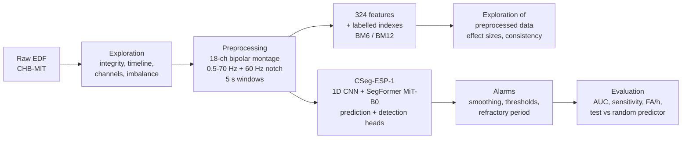

# Epileptic Seizure Prediction and Detection from Scalp EEG
### A lightweight CNN–SegFormer pipeline (CSeg-ESP-1) on the CHB-MIT database


-green)


Epileptic seizures are unpredictable. This project builds, from the raw EEG up to clinically-oriented evaluation, a complete pipeline that **detects** a seizure while it happens and **predicts** it minutes in advance, on the paediatric **CHB-MIT** scalp EEG database (686 recordings, 983 h, 198 seizures, 23 patients).

It is a rigorous reproduction and extension of **CSeg-ESP-1** from the [CViT-ESP](https://github.com/pcdslab/CVitEsp) framework (a 1D CNN that turns each EEG window into an image for a pre-trained SegFormer MiT-B0), with an added detection head, calibrated thresholds, a chronological leakage-checked protocol, and a conservative statistical test against a random predictor.

> Academic project — *Signal Processing for Data Science*, 3rd year Telecommunications, National Engineering School of Tunis (ENIT), University of Tunis El Manar, 2026–2027.
> The full report is in [`docs/Seizure_Prediction_Report_v2.pdf`](docs/Seizure_Prediction_Report_v2.pdf).

---

## Key results

17 subjects, 43 evaluable test seizures, strictly chronological split (first 60 % of each patient's leading seizures for training, last 40 % for testing), BM12 protocol (30-min preictal window, 5-min horizon).

| Approach | Training data | Prediction AUC | Seizures predicted | False alarms / h | Detection AUC | Seizures detected |
|---|---|---|---|---|---|---|
| **A. Patient-specific** | the patient only | 0.638 ± 0.193 | **33 / 43** | 1.33 | 0.989 | 92 % |
| **B. Zero-shot** | other patients | 0.499 ± 0.196 | 8 / 43 | 0.56 | 0.890 | 59 % |
| **B + patient thresholds** | other patients, thresholds calibrated on the patient | 0.499 ± 0.196 | 19 / 43 | 0.82 | 0.890 | 66 % |
| **C. Personalised** | B fine-tuned on the patient | 0.634 ± 0.253 | 23 / 43 | 1.03 | 0.991 | 96 % |

**Take-aways**

- **Detection works, and transfers across patients.** AUC 0.99 with patient data, 0.89 on patients never seen (ictal effect size ≈ 2, same direction for ≥ 90 % of patients).
- **Patient-specific prediction works.** It anticipates 33 of 43 seizures, about **15 minutes in advance**, significantly better than a random predictor (**p = 0.002**, conservative false-alarm estimate; 0.013 with the most severe estimate).
- **Prediction on unseen patients stays at chance level** (AUC 0.50, p ≈ 1). The preictal effect is small and has the opposite sign for about 40 % of patients.
- Personalisation and threshold calibration improve detection and sensitivity but **cannot be claimed to improve prediction significantly** once false alarms are estimated conservatively.

In short: *ictal signatures are shared across patients; preictal signatures are largely patient-specific.*

---

## Pipeline



### 1. Exploratory analysis of the raw EEG
Integrity of the EDF files, seizure annotations (`summary.txt` ∪ `.seizures`), absolute timeline reconstruction (midnight crossings, overlaps), montages and missing channels, class imbalance (**0.33 % of the time in seizure**), time of day, power-line noise, and inter-patient amplitude variability (a factor of about 10 between patients). Every finding is linked to a preprocessing decision.

### 2. Preprocessing and features
- **Common 18-derivation bipolar montage** ("double banana"), duplicated channels merged, missing derivations reconstructed or masked.
- **Band-pass 0.5–70 Hz + 60 Hz notch** (zero-phase FIR), clipping at ±3000 µV, flat-channel masking, artefact flag > 1000 µV.
- **5 s non-overlapping windows** at 256 Hz (18 × 1280), equal data budget per patient.
- Result: **298,629 windows, 414.8 h** from the 983 h, stored as float16 + Parquet.
- **324 hand-crafted features** per window (18 per derivation: band powers, Hjorth parameters, line length, variance, skewness, kurtosis, SEF90, spectral entropy) used to quantify what separates the classes (Cohen's d and consistency across patients).

### 3. Model: CSeg-ESP-1 with a detection head
- 1D CNN (18 → 64 → 128 → 256 → 320 channels) turns a window into a 320 × 320 "image".
- Pre-trained **SegFormer MiT-B0** (`nvidia/mit-b0`) encoder; fine-tuning strategy "1000" (CNN, patch embedding and first transformer stage trainable).
- Two linear heads: **prediction** (preictal vs interictal) and **detection** (ictal vs rest).
- **3.79 M parameters, 0.64 M trainable**: light enough for embedded use.
- Log amplitude normalisation `sign(x)·log(1+|x|/50 µV)`, augmentation (gain, channel dropout, noise), balanced batches (40 % interictal / 40 % preictal / 20 % ictal, patients drawn uniformly).

### 4. From probabilities to alarms and evaluation
- Causal smoothing (1 min for prediction, 10 s for detection), thresholds chosen on held-out data (Youden point with a minimum specificity, bounded to [0.5, 0.99]), refractory periods (30 min / 60 s).
- Metrics: window-level AUC, **event-level sensitivity**, **false alarms per hour**, warning time, detection latency.
- **Leakage control**: chronological split, automatic checks that no preictal window of a test seizure falls on the training side.
- **Statistical validation**: paired Wilcoxon tests across subjects, and a pooled test against a random predictor (Poisson-binomial) with a *conservative* false-alarm estimate, so the benefit is not overstated when a patient has zero false alarms on a short test period.

---

## Dataset

[CHB-MIT Scalp EEG Database](https://physionet.org/content/chbmit/1.0.0/) (PhysioNet): long-term scalp EEG of paediatric patients with intractable seizures, 256 Hz, 23 channels or fewer per file.

The data is **not included** in this repository. Download it from PhysioNet, or from the Kaggle mirror used in our notebooks (`abhishekinnvonix/seizure-epilepcy-chb-mit-eeg-dataset-pediatric`). Please check the dataset's terms of use on PhysioNet.

| | Raw | After preprocessing |
|---|---|---|
| Recordings / subjects | 686 EDF files, 24 subjects (23 patients) | 23 patients |
| Duration | 983 h | 414.8 h (298,629 windows of 5 s) |
| Seizures | 198 | — |
| Labelled windows (BM12) | — | 212,339 interictal / 44,469 preictal / 2,401 ictal |

---

## Repository structure

The project was run as five Kaggle notebooks, in this order:

| # | Notebook | Content | Hardware |
|---|---|---|---|
| 1 | Raw data exploration | inventory, integrity, annotations, timeline, channels, imbalance, raw signal | CPU, minutes |
| 2 | Preprocessing | timeline, montage, filtering, segmentation, 324 features, labelled indexes | CPU, ≈ 1 h |
| 3 | Preprocessed data exploration | class distribution, signals, feature distributions, topomaps, effect sizes | CPU |
| 4 | Single-patient study | CSeg-ESP-1 on one subject (chb05), approaches A, B, B + thr., C | T4 GPU, ≈ 15 min |
| 5 | Multi-patient study (BM12) | same procedure on 17 subjects, summary and statistical tests | T4 GPU, ≈ 3 h |

```
.
├── README.md
├── docs/
│   └── Seizure_Prediction_Report_v2.pdf     # full report
├── notebooks/
│   ├── 1_raw_data_exploration.ipynb
│   ├── 2_preprocessing.ipynb
│   ├── 3_preprocessed_data_exploration.ipynb
│   ├── 4_single_patient_study.ipynb
│   └── 5_multi_patient_study_bm12.ipynb
└── requirements.txt
```

## Getting started

1. Get the CHB-MIT data (see above) and attach it to your environment. On Kaggle, add it as an input dataset.
2. Install the dependencies: `mne`, `wfdb`, `numpy`, `scipy`, `pandas`, `pyarrow`, `scikit-learn`, `matplotlib`, `torch`, `transformers`.
3. Run the notebooks **in order**. Notebook 2 writes the preprocessed dataset (signals, windows, features, labelled indexes) that notebooks 3 to 5 read.
4. Notebooks 4 and 5 train on a single GPU (NVIDIA T4 is enough). Loading the 13.8 GB of signals in RAM makes an epoch take under a minute instead of 49 minutes with random disk reads.

---

## Limitations

- Few test seizures per patient (1 to 6), so individual results are noisy; conclusions rely on pooled tests.
- CHB-MIT is 23 paediatric patients from a single centre.
- Filters are non-causal and fixed instrumental lines remain in the signal; fixed frequency bands do not account for rhythm changes with age.
- Part of the preictal effect may reflect vigilance or muscle activity rather than genuine preictal dynamics.
- For some subjects the chronological split leaves little interictal data on one side (e.g. chb03 in training, chb10 and chb13 in test).
- This is a research prototype, **not a medical device**.

## Future work

- Systematic **leave-one-patient-out** evaluation on the 23 patients, with feature-based baselines to measure the real contribution of the transformer.
- Methods that **align representations across patients**, or adapt a general model from the first seizure of a new patient.
- Causal filtering, age-adapted frequency bands and removal of fixed instrumental lines, towards an embedded application.

---

## References

- U. Mohammad, P. Parani, F. Saeed. *CViT-ESP: Lightweight pre-trained vision transformers for EEG-based epileptic seizure prediction.* bioRxiv, 2026. doi:10.64898/2026.08.21.746341. Code: <https://github.com/pcdslab/CVitEsp>
- A. H. Shoeb. *Application of Machine Learning to Epileptic Seizure Onset Detection and Treatment.* PhD thesis, MIT, 2009.
- A. L. Goldberger et al. *PhysioBank, PhysioToolkit, and PhysioNet.* Circulation, 2000.
- E. Xie et al. *SegFormer: Simple and Efficient Design for Semantic Segmentation with Transformers.* NeurIPS, 2021.

## Authors

- **Yosser Jabloun**
- **Mariem Rabhi**

Supervised by **Mrs. Asma Baghdadi** — National Engineering School of Tunis (ENIT), Information and Communication Technologies Department.

## Citation

```bibtex
@techreport{jabloun_rabhi_2026_cseg_esp_chbmit,
  title       = {Epileptic Seizure Prediction and Detection from Scalp EEG Based on a Lightweight CNN--Vision Transformer (CSeg-ESP-1)},
  author      = {Jabloun, Yosser and Rabhi, Mariem},
  institution = {National Engineering School of Tunis, University of Tunis El Manar},
  year        = {2026},
  note        = {Academic project report, supervised by Asma Baghdadi}
}
```

## License

Choose a license before publishing (e.g. MIT for the code). The CHB-MIT data keeps its own PhysioNet terms and is not redistributed here.
